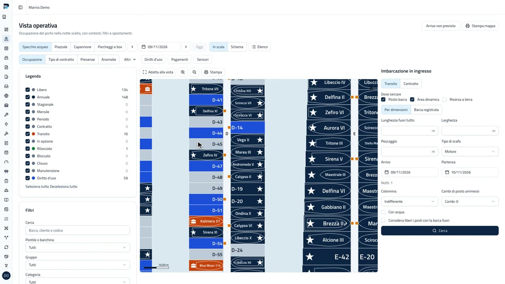

<div align="center">

<picture>
  <source media="(prefers-color-scheme: dark)" srcset="assets/brand/porto/outlined/porto_logo_horizontal_inverted_2color.svg">
  
</picture>

# Porto

**Il gestionale gratuito per porti turistici, marine, approdi e cantieri nautici, con codice sorgente disponibile.**
Mappa del porto in scala reale, contratti di ormeggio e transiti, prenotazione online dei posti barca senza commissioni, addebiti e incassi, rimessaggio, cantiere e noleggio: un unico binario per il tuo server, oppure un'app desktop che lavora anche senza internet.

[](LICENSE)
[](https://go.dev)
[](https://react.dev)
[](https://github.com/coste360/porto/pkgs/container/porto)
[](https://docs.portomarina.app/installazione/database/)
[](https://github.com/coste360/porto/actions)
[](https://github.com/coste360/porto/releases/tag/v1.0.0)

**[Documentazione](https://docs.portomarina.app)** · [portomarina.app](https://portomarina.app) · [Demo](https://demo.portomarina.app) · [Scarica](#scarica) · [Licenza](#licenza-e-marchio)

<br>

<a href="https://assets.coste360.it/assets/porto-presentazione-v1.mp4">
  
</a>

</div>

---

**Porto** è un software gratuito per la gestione di porti turistici, marine, approdi e cantieri nautici, sviluppato da [Coste360 SRL](https://www.coste360.it/). Lo installi dove vuoi: sul PC dell'ufficio, su un mini PC in sede o su un tuo server online. I dati restano tuoi e nessuna prenotazione paga una percentuale a qualcuno.

- **Mappa del porto in scala reale**: banchine, pontili, campi boe, aree dinamiche, piazzali e capannoni, con la vista operativa di ogni notte.
- **Contratti di ormeggio e transiti**: preventivi, rate, rinnovi, firma, diritti d'uso e spese condominiali.
- **Prenotazione online dei posti barca**, incorporabile nel sito del porto con una riga di codice, con i pagamenti sul tuo account Stripe e nessuna commissione alla piattaforma.
- **Addebiti e incassi** esportati "da fatturare" verso il software di fatturazione che usi già: Porto non emette fatture.
- **Rimessaggio, cantiere, noleggio, sensori di occupazione e report** nella stessa installazione, con più marine e ruoli.
- **App desktop** per Windows, macOS e Linux che lavora senza internet; ormeggiatori e cantiere usano il pannello dal telefono, anche offline.

Tutte le milestone della specifica, da M0 a M12, sono implementate e verificate da test automatici; la versione 1.0.0 è il primo rilascio pubblico. Porto è fornito così com'è, senza garanzie (vedi [LICENSE](LICENSE)): per un'installazione verificata e con assistenza scrivi a [Coste360](https://www.coste360.it/contatti).

## Scarica

| | Dove |
|---|---|
| **Server** (VPS, mini PC, NAS) | Immagine Docker `ghcr.io/coste360/porto` · [guida all'installazione](https://docs.portomarina.app/installazione/scegli-come-installare/) |
| **App desktop** (Windows, macOS, Linux) | [portomarina.app/download](https://portomarina.app/download/) |
| **Telefono dello staff** | Nessuna app da installare: il pannello si apre dal browser (PWA) collegandosi al server o all'app desktop |

Su GitHub ci sono i sorgenti e le istruzioni di build; i pacchetti pronti dell'app desktop non vengono pubblicati qui.

**Prova in locale in un minuto** (compila l'immagine dai sorgenti, nessuna configurazione):

```bash
git clone https://github.com/coste360/porto.git && cd porto
PORTO_BOOTSTRAP_OWNER_EMAIL=titolare@porto.test PORTO_BOOTSTRAP_OWNER_NAME="Mario Rossi" \
PORTO_BOOTSTRAP_OWNER_ORG="Marina Prova SRL" PORTO_ADMIN_PASSWORD=password-di-prova \
  docker compose up --build        # oppure: make up
```

Poi apri `http://localhost:8080/admin/` e accedi con le credenziali indicate (password di almeno 12 caratteri); per il porto dimostrativo: `docker compose exec porto /porto seed demo`. Questo `compose.yaml` è per lo sviluppo: per un server segui la [guida Docker](https://docs.portomarina.app/installazione/docker/).

## Documentazione

Tutto il resto è su **[docs.portomarina.app](https://docs.portomarina.app)**, in italiano e in inglese:

- [Cos'è Porto](https://docs.portomarina.app/installazione/): stato delle funzionalità, limiti noti, roadmap, accessibilità
- [Installazione e gestione](https://docs.portomarina.app/installazione/scegli-come-installare/): Docker, app desktop, configurazione, HTTPS, backup, aggiornamenti
- [Guida del gestore](https://docs.portomarina.app/gestore/): mappa, contratti e transiti, prezzi, addebiti, prenotazione online e widget
- [API e webhook](https://docs.portomarina.app/api/): riferimento OpenAPI, autenticazione, eventi
- [Sviluppo ed estensioni](https://docs.portomarina.app/sviluppo/): architettura, invarianti, driver, contributi
- [Domande frequenti](https://docs.portomarina.app/installazione/domande-frequenti/)

Per chi sviluppa: [`AGENTS.md`](AGENTS.md) (comandi `make`, regole non negoziabili), la [specifica](docs/spec/README.md), le [invarianti](docs/invariants.md) e gli [ADR](docs/adr/README.md). Il sito della documentazione si genera da [`docs-site/`](docs-site/) (`make docs-dev`). Le novità di ogni versione sono nel [CHANGELOG](CHANGELOG.md).

## Contribuire e sicurezza

Segnalazioni dai porti e dai cantieri, correzioni, traduzioni, driver ed esportatori sono benvenuti: leggi [CONTRIBUTING.md](CONTRIBUTING.md) e il [Codice di condotta](CODE_OF_CONDUCT.md), e apri una issue prima di una modifica non banale. Per le vulnerabilità non aprire issue pubbliche: scrivi a **security@coste360.it** seguendo la [policy di segnalazione](SECURITY.md).

## Licenza e marchio

Porto è **source available** con licenza **[Business Source License 1.1](LICENSE)** (SPDX `BUSL-1.1`):

- **gratuito** per installare e usare Porto per i porti, gli approdi, i cantieri e i rimessaggi che possiedi o gestisci direttamente;
- **non rivendibile**: offrirlo a terzi a pagamento o con altro vantaggio commerciale (hosting, SaaS, installazione, personalizzazione, assistenza, rivendita) richiede una licenza commerciale di Coste360 SRL (**info@coste360.it**);
- ogni versione passa ad **AGPL-3.0 o successiva** tre anni dopo il suo primo rilascio pubblico.

Il testo vincolante è il file [LICENSE](LICENSE); i casi pratici (agenzie, consorzi, siti web, modelli di installazione) sono nella pagina [Licenza e marchio](https://docs.portomarina.app/sviluppo/licenza/) e nell'[ADR 0018](docs/adr/0018-licenza.md). Il nome **Porto** e il logo sono marchi di Coste360 SRL, esclusi dalla licenza del codice: vedi [TRADEMARK.md](TRADEMARK.md) e l'[ADR 0007](docs/adr/0007-marchio.md).

---

## In English

**Porto** is a free, self-hosted, source-available management system for marinas, tourist ports, berthing points and boatyards, developed by [Coste360 SRL](https://www.coste360.it/). It covers the whole marina cycle: a to-scale harbour map with a nightly operational view, customers and vessels, price lists, mooring contracts and transits, berth-use rights and condominium charges, charges and payments, dry storage, boatyard, rentals, occupancy sensors and reports. Online berth booking can be embedded in any website, with no booking commissions: payments go through the marina's own Stripe account. Porto does not issue invoices; charges are exported to the marina's invoicing software. It ships as a single Go binary and Docker image (`ghcr.io/coste360/porto`) with SQLite by default and optional PostgreSQL, and as a desktop app that works offline, available from [portomarina.app/download](https://portomarina.app/download/). Staff phones use the panel in the browser (PWA). It contains no AI features and no telemetry.

It is source-available under the [Business Source License 1.1](LICENSE): free for marinas, boatyards and dry-storage facilities that run it for sites they own or operate directly; offering it to third parties for a fee or other commercial advantage requires a commercial license from Coste360 SRL. Each version converts to AGPL-3.0 or later three years after its first public release. The Porto name and logo are not covered by the code licence. Documentation: [docs.portomarina.app/en](https://docs.portomarina.app/en/).
